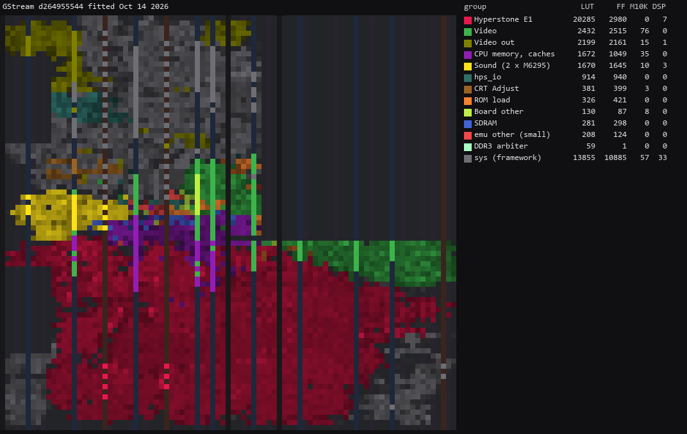
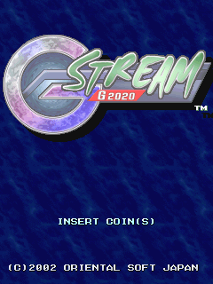

# GStream core for MiSTer

A MiSTer FPGA core for Oriental Soft's Hyperstone E1-32XT arcade board (MAME's `promat/gstream.cpp`), built with
Quartus Prime 17.0.2 Lite for the DE10-nano.

**Status: G-Stream G2020 plays on the board with sound. The X2222 sets are not in yet.**

## Contents

- [History](#history)
- [Games](#games)
  - [Supported](#supported)
  - [Not yet](#not-yet)
- [Hardware](#hardware)
  - [Video timing](#video-timing)
  - [Floorplan](#floorplan)
- [Screenshots](#screenshots)
- [Installation](#installation)
- [Controls](#controls)
- [Status](#status)
  - [Features](#features)
  - [Todo](#todo)
  - [Resource usage](#resource-usage)
- [AI Attestation](#ai-attestation)
- [Verification](#verification)
- [Acknowledgements](#acknowledgements)
- [Layout](#layout)
- [License](#license)

## History

* **20261014** (`releases/Arcade-GStream_20261014.rbf`, commit `d264955`)
  * Initial release: G-Stream G2020
  * The Hyperstone E1 from Arcade-Vamphalf_MiSTer at 60.75 MHz; graphics read from DDR3
  * Two OKI M6295s with a 3.5 kHz output low-pass (OSD Audio Filter)
  * Fast ROM loading, the backup RAM saved to the `.nvm`, CRT Adjust, flip screen, HDMI rotation

## Games

One board: the E1-32XT at 64 MHz, two M6295s, three tilemaps of 32 x 32 tiles and 832 16 x 16 sprites, all 8 bpp
through a 15-bit palette. MAME's driver also runs X2222 and its prototype on the same board with 16-bit direct
colour and no sound ROM; those are Phase 4 of `docs/ROADMAP.md`.

### Supported

| Name | Year | Manufacturer | Set | Notes |
|-|-|-|-|-|
| G-Stream G2020 | 2002 | Oriental Soft Japan | `gstream` | Playable |

### Not yet

| Name | Why |
|-|-|
| X2222 (final debug?) (`x2222`) | 16-bit direct colour and its own map not written yet (`docs/ROADMAP.md`, Phase 4). Silent in MAME: no sound ROM dumped |
| X2222 (5-level prototype) (`x2222o`) | As `x2222`; MAME marks its graphics imperfect (program and sprite ROMs do not match) |

## Hardware

| Chip | Function | Status |
|-|-|-|
| Hyperstone E1-32XT, 64 MHz | Main CPU | Arcade-Vamphalf_MiSTer's `e1_pipe` (written there from MAME's `e132xs`), unchanged, run on every 60.75 MHz clock with its timer at 64 MHz; memory unit generated from Vamphalf's `vh_cpumem.sv` for this map (`scripts/gen_gs_cpumem.py`) |
| Graphics (two XC95288 CPLDs) | Three 16 x 16 tilemaps of 32 x 32 tiles, 832 sprites of 16 x 16, 8 bpp, BGR565 palette | Written here from MAME's `screen_update` (`rtl/video/gs_video.sv`): drawn per line, tiles and sprites read from DDR3 |
| 2 x AD-65 (OKI M6295), 1 MHz, pin 7 high | ADPCM sound, mono, banked through I/O 0x100c | jotego's JT6295 with the Fuuki core's ROM bridge and sample cache (`rtl/sound/`); a 4th-order low-pass at 3.5 kHz on the mix |
| Backup RAM, 8 KB | Settings and scores | Block RAM, MAME's default image in the `.mra`, saved to the `.nvm` |

### Video timing

MAME has no raster: `set_refresh_hz(60)`, `set_size(320, 240)`, no blanking (`gstream.cpp:844-847`). The core uses
6.75 MHz pixels (27 MHz crystal / 4) on 432 x 262, the driver's sprite budget constant: 15.625 kHz lines,
59.64 Hz frames, 320 x 240 visible. A guess, not measured on a board (`docs/HACKS.md`).

### Floorplan

Where the logic sits on the Cyclone V, read from the compiled design with `scripts/floorplan.py` (blocks defined in
`scripts/floorplan.json`). One cell per LAB, M10K or DSP site, coloured by the block owning most of it, brighter when
fuller. The thin columns are M10K and DSP; the empty area at the top right is the HPS; grey is the MiSTer framework.
LUT counts are combinational cells, two per ALM.

Revision `GStream` at `d264955` (the 20261014 release), fitted 14 Oct 2026 (`docs/floorplan/GStream_groups.md`):

## Screenshots

### G-Stream G2020

## Installation

32 MB SDRAM module is required.

* Take the latest `Arcade-GStream_*.rbf` from `releases/` and put it in `_Arcade/cores`, renamed to drop the
  `Arcade-` prefix (`Arcade-GStream_YYYYMMDD.rbf` becomes `GStream_YYYYMMDD.rbf`)
* Put the `*.mra` files from `releases/` in `_Arcade` (or a subdirectory starting with an underscore, e.g.
  `_Arcade/_GStream`)
* Put the MAME `gstream` ROM set in `games/mame`

To build and deploy a development build: `python scripts/build_staged.py`, then `python scripts/deploy.py` with a
`mister.env` (see `scripts/deploy.py`).

## Controls

Pad: Shot, Bomb, Start, Coin, Pause, Service Coin, Service Mode. Buttons 3 and 4 are wired (the game's input test
lists PUSH1-4) but did nothing in play in MAME, so the `.mra` leaves them unnamed. Pause suspends the CPU. The game has no DIP switches; its settings are in the test menu (Service Mode) and
kept in the backup RAM. Two players.

Keyboard, MAME's defaults: arrows / R F D G, buttons LCtrl LAlt Space LShift / A S Q W, Start 1 / 2, Coin 5 / 6; F2
service switch, 9 service coin, P pause.

## Status

Known issues:

* **The CPU is slower per instruction than the original** (`docs/HACKS.md`): on the board, after a clear in play,
  0 of 10,234 frames lost, the busiest at 94.6% of the frame; the first 127 frames after power-on are lost, on the
  board as on the bench. Heavier scenes than that run have not been measured.
* The frame rate is 59.64 Hz against MAME's 60 Hz (Video timing).
* The output low-pass is chosen to match MAME's spectrum; the board's own analog filter is not known
  (`docs/HACKS.md`).
* Not yet checked on the board: the `.nvm` save and restore, flip screen, CRT Adjust, rotation, Pause.

`docs/MAME_KLUDGES.md` lists what is taken from MAME as behaviour and what is known not to be right. `docs/HACKS.md`
lists this core's own approximations. `docs/ROADMAP.md` is the plan and its progress; `docs/LESSONS_LEARNED.md` is
what it cost.

### Features

* DIP switches from the `.mra`: n/a, the game has none
* Inputs: two players, four buttons, coin, start, service coin, Service Mode
* CRT Adjust (H-Position, V-Shift, H-Size): done, not checked on the board
* HDMI scaling (integer scale): done
* HDMI rotation (orientation): done, not checked on the board
* Flip screen, HDMI and analog, from the OSD (the game has no flip): done, checked in simulation
* HDMI-only options hidden under direct video: not yet
* Peripheral menus, rotary joysticks, light guns: n/a
* Audio mix: n/a, mono
* Hiscore saving: no `hiscore.dat` entry for this driver; the game's 8 KB backup RAM is saved to the `.nvm` (whether it holds the scores is not checked)
* NVRAM saved to the `.nvm` file: done, not checked on the board
* Fast ROM loading via DDR: done
* Pause (with CPU suspended): done, not checked on the board
* Sound: two M6295s, OSD Audio Filter On (default) / Off
* Savestates: not yet
* Cheats: not yet

### Todo

- [ ] X2222 and X2222 (prototype) (`docs/ROADMAP.md`, Phase 4)
- [ ] The `.nvm`, flip, CRT Adjust, rotation and Pause on the board
- [ ] CPU speed in the heaviest scenes

### Resource usage

The release revision (`GStream`, commit `d264955`, default seed) on the DE10-nano's Cyclone V 5CSEBA6, speed grade 7,
every clock meeting timing (clk_sys +0.909 ns, HDMI +0.391 ns; worst hold +0.242 ns):

| resource | used | available |
| --- | --- | --- |
| Logic (ALMs) | 25,735 | 41,910 |
| Block memory bits | 1,345,529 | 5,662,720 |
| RAM blocks | 204 | 553 |
| DSP blocks | 44 | 112 |
| PLLs | 3 | 6 |

The one to watch is clk_sys's setup margin (+0.909 ns at 60.75 MHz), not logic or memory.

## AI Attestation

This core is being developed with heavy use of a frontier coding assistant.

## Verification

Not PCB-validated. MAME's `gstream.cpp`, `e132xs` and `okim6295` are the reference; where the core follows MAME on
something MAME marks as uncertain it is in `docs/MAME_KLUDGES.md`, and the core's own approximations are in
`docs/HACKS.md`.

* CPU: the copied `e1_pipe` passes Vamphalf's conformance suite, 104 of 104 runs, every line identical to Vamphalf's
  own run (`scripts/e1_regress.py --replay --pipe`).
* Whole board (`sim/sys_tb`, the SDRAM controller and a chip model) against MAME's trace from reset: PCs agree for
  785,785 instructions, to the core's first vertical-blank interrupt, and all 348,922 data accesses before it. In
  attract mode the VRAM at every frame's end equals MAME's for 2,331 of 2,331 frames (offset by the core's slower
  boot).
* Video: `scripts/render_model.py`, a transcription of `screen_update`, is pixel-identical to MAME on 9 of 9
  captured frames (attract and play) and on 179 of 179 sampled every 10 from 1510 to 3290; the video RTL (`sim/video_tb`) is identical to the model on the frames tried
  (9 of 9, and the six with the most sprites on a line, up to 73) with DDR3 latency up to 80 clocks; the whole board
  in play, 17 of 17 sampled frames identical to the model on the state they were drawn from. Flip: three frames
  identical to the model turned 180 degrees.
* `.mra`: the image is identical to MAME's ROM_START image (`scripts/build_mra.py`).
* Sound: the OKI commands and bank changes on the bench equal MAME's byte for byte (`sim/sys_tb +okilog`,
  `scripts/mame/okilog.lua`); the power-on sound's length and pitch equal MAME's (correlation 0.95). On the board,
  the 2 MB of sample ROMs read back from SDRAM equal the image, twice, and no ADPCM byte reached the chip late
  (`docs/ROADMAP.md`, Progress). The sample data's bit order: of all 40,320 orderings, the ROMs' own is the one that
  decodes without the ADPCM signal reaching its clamp (`scripts/oki_bitorder.py`). The output low-pass equals
  `scripts/snd_filter.py`'s model on 1,206,870 of 1,206,870 samples.

## Acknowledgements

- **Sorgelig** and the **MiSTer-devel team** for the
  [Template_MiSTer](https://github.com/MiSTer-devel/Template_MiSTer) framework, Sorgelig's `sdram.v` (here by way
  of the Psikyo, Fuuki, KonamiGX and Vamphalf cores) and `screen_rotate`.
- The **MAMEdev team**: David Haywood (`gstream.cpp`), Pierpaolo Prazzoli (`e132xs`), for the driver and device
  emulations that are this core's specification.
- **Jose Tejada (jotego)** for JT6295 ([jt6295](https://github.com/jotego/jt6295)).
- **Umberto Parisi (rmonic79)** for `crt_adjust.sv`, by way of the Vamphalf core.
- [Arcade-Vamphalf_MiSTer](https://github.com/ppriest/Arcade-Vamphalf_MiSTer) for the E1 CPU, its caches and memory
  unit, the ROM loader and the debug probes (`THIRD-PARTY.md`).

## Layout

Standard [Template_MiSTer](https://github.com/MiSTer-devel/Template_MiSTer) structure:

| path | contents |
| - | - |
| `sys` | MiSTer framework, vendored from the template, never edited |
| `rtl` | core source; vendored modules carry a `PROVENANCE.md` |
| `releases` | `.rbf` and `.mra` files |
| `docs` | roadmap, workflow, release process, kludges, hacks, lessons |
| `sim` | Verilator testbenches |
| `scripts` | build, deploy, capture and verification tooling |
| `debug` | reference captures from MAME used as ground truth (gitignored) |
| `roms` | your own MAME sets (gitignored, never committed) |

## License

GPL-3.0-or-later (see `LICENSE`). Imported components keep their own licences; `THIRD-PARTY.md` has the detail and
every modified vendored file states the change in its header.

Game ROMs contain copyrighted material and are not included. Obtaining them is your responsibility.
